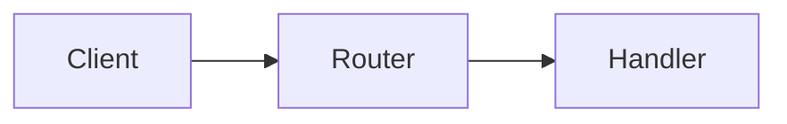

# Markdown conventions

Chapters are CommonMark with GFM tables, rendered by `assets/book.js`. Use only the constructs
below. They render the same in the HTML reader and in the PDF.

## Code citations

| Write | Renders as |
|---|---|
| `[[src/app.py:10-24]]` | a link to lines 10–24 at the chapter's commit |
| `[[src/app.py:42]]` | a single line |
| `[[src/app.py]]` | the whole file |

Paths are relative to the repository root and contain no spaces. Line numbers must exist at the
recorded commit, and `check_citations.py` verifies this.

### Jupyter notebooks

Never quote a notebook's raw JSON. Cite a **cell** instead: `demo.ipynb#cell-8` is the 8th cell,
counting from 1 and including markdown cells. Line numbers are counted inside that cell.

| Write | Means |
|---|---|
| `[[demo.ipynb#cell-8]]` | the whole cell |
| `[[demo.ipynb#cell-8:5-9]]` | lines 5–9 of that cell |
| ```` ```python demo.ipynb#cell-8 "Training loop" ```` | a listing of the cell's source, as clean Python |

To list the cells with their numbers:
`python3 -c "import json,sys;[print(i,c['cell_type'],''.join(c['source'])[:60].replace(chr(10),' | ')) for i,c in enumerate(json.load(open(sys.argv[1]))['cells'],1)]" path/to/nb.ipynb`

## Listings (code excerpts)

````markdown
```python src/app.py:10-24 "Request dispatch"
def dispatch(request):
    ...
    return handler(request)
```
````

- The info string is `lang path:a-b "Optional caption"`. The listing is numbered (Listing 4.2) and
  its caption links to the source.
- The body must be **verbatim** from the cited range. You may:
  - remove common leading indentation;
  - replace skipped lines with a line containing only `...` (or `# ...` / `// ...`).

  Nothing else: no added comments, renamed variables or reformatting. Put annotations in the prose.
- To show code that is *not* from the repo, such as a standalone example in Foundations, use a plain
  fence (` ```python `) or add a caption without a path (` ```python "A minimal example" `).

## Diagrams

````markdown

````

Mermaid diagrams are numbered (Figure 4.1) and drawn in a neutral monochrome theme. Prefer
`flowchart LR/TD`, `sequenceDiagram` and `classDiagram`. Keep them to about 10 nodes or fewer, use
short labels, and do not style or color nodes.

## Math

Inline: `$y = \sigma(z)$`. Display: a paragraph of its own:

```markdown
$$
\frac{\partial L}{\partial w} = \delta\, x
$$
```

Do not put a space just inside the dollar signs. A dollar amount such as "$5" is safe as long as
there is no closing `$` on the same line.

## Boxes

```markdown
> [!PRIMER] Why the sigmoid derivative is cheap
> One paragraph of background the reader may lack.
```

| Type | Use for |
|---|---|
| `[!PRIMER] Title` | Brief background on a prerequisite (the chapter's `primers`) |
| `[!NOTE]` | An aside worth knowing; use sparingly |
| `[!PITFALL] Title` | A mistake or trap specific to this code |
| `[!DEFINITION] Term` | A formal definition you want set apart |
| `[!EXERCISE] Optional title` | An exercise (numbered automatically: Exercise 4.1) |

## Exercise solutions

Put a `<details>` block **immediately after** the exercise box, with blank lines around its content:

```markdown
> [!EXERCISE] Predict the effect of the learning rate
> Change `lr` to `5.0` in [[tinynet/model.py:23]] and predict the outcome.

<details>
<summary>Solution</summary>

Large steps overshoot; learning stalls.

</details>
```

On screen, the solution is collapsible. In the PDF, solutions move to a "Solutions to Exercises" appendix.

## Defined terms and the index

Wrap the **defining** occurrence of a term: `<dfn>backpropagation</dfn>`. Each `<dfn>` becomes an
index entry with a page number. To index a term under a different name, use
`<dfn title="error signal">δ</dfn>`.

## Cross-references

- To another chapter: `[Chapter 2](ch02-backpropagation.md)`.
- To one of its sections: `[the bridge table](ch02-backpropagation.md#bridge-to-this-repository)`.
  The anchor is the heading text in lowercase, with spaces replaced by `-` and punctuation removed.
- Within the same chapter: `[see below](#design-decisions)`.

Always link by chapter id, never by number, because numbers change when chapters are reordered.

## Headings

- `#`: the chapter title. Use it exactly once, on the first line.
- `##`, `###`: numbered sections (4.1, 4.1.1).
- `####`: an unnumbered run-in heading. Use it rarely.

## Feedback comments (for revision)

Readers can leave `<!-- feedback: make this shorter -->` anywhere in a chapter. These are invisible
when rendered. `revise --from-comments` applies them and then removes them.

## Avoid

- Raw HTML other than `<dfn>`, `<details>`, `<summary>`, `<sub>` and `<sup>`.
- Images. They are not bundled into the book. Draw a Mermaid diagram instead.
- Emoji, colored text, badges, or a hand-written table of contents.
