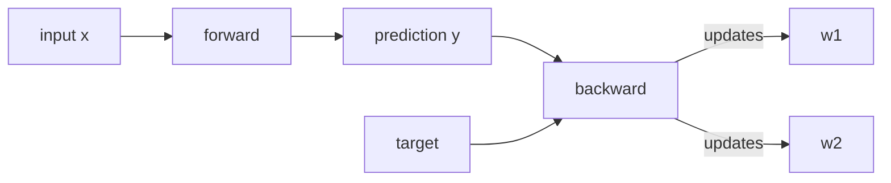

# Backpropagation: How TinyNet Learns

**Learning objectives.** After this chapter you will be able to:

- derive the gradient of the loss with respect to every weight in a two-layer network;
- point to the line in `tinynet` that computes each term of that derivation;
- predict how changing the learning rate in [[tinynet/model.py:23]] changes training.

This chapter builds on [the forward pass](ch01-big-picture.md#the-forward-pass) from Chapter 1.

## Foundations

### Intuition

A network makes a prediction, measures how wrong it was, and then asks of every weight: *if I nudged you slightly, how much would the error change?* <dfn>Backpropagation</dfn> answers that question for all weights at once by applying the chain rule backwards, from the output toward the input, reusing each intermediate result instead of recomputing it.

### The formal statement

For a single example with target $t$ and prediction $y = \sigma(z)$, where $z = \sum_j w^{(2)}_j h_j$, the squared-error loss is

$$
L = \tfrac{1}{2}(y - t)^2 .
$$

The chain rule gives the <dfn>error signal</dfn> at the output,

$$
\delta_{\text{out}} = \frac{\partial L}{\partial z} = (y - t)\,\sigma'(z) = (y - t)\,y\,(1 - y),
$$

and from it every gradient follows:

$$
\frac{\partial L}{\partial w^{(2)}_j} = \delta_{\text{out}}\, h_j,
\qquad
\delta_j = \delta_{\text{out}}\, w^{(2)}_j\, h_j (1 - h_j),
\qquad
\frac{\partial L}{\partial w^{(1)}_{ji}} = \delta_j\, x_i .
$$

Here $\sigma$ is the sigmoid, $h_j$ the activation of hidden unit $j$, and $x_i$ input $i$.

### A worked example by hand

Take one hidden unit, $x = 1$, $w^{(1)} = 0.5$, $w^{(2)} = 1$, target $t = 0$. Then $h = \sigma(0.5) \approx 0.622$, $y = \sigma(0.622) \approx 0.651$, so $\delta_{\text{out}} = 0.651 \cdot 0.651 \cdot 0.349 \approx 0.148$. The gradient for $w^{(2)}$ is $0.148 \cdot 0.622 \approx 0.092$: a positive gradient, so gradient descent will *decrease* $w^{(2)}$, pushing $y$ toward the target.

### Bridge to this repository

| Textbook symbol | In `tinynet` | Where |
|---|---|---|
| $\delta_{\text{out}}$ | `delta_out` | [[tinynet/model.py:25]] |
| $\partial L / \partial w^{(2)}_j$ | `grad_w2[j]` | [[tinynet/model.py:26]] |
| $\delta_j$ | `delta_hidden[j]` | [[tinynet/model.py:27]] |
| $\partial L / \partial w^{(1)}_{ji}$ | `delta_hidden[j] * self.x[i]` | [[tinynet/model.py:30]] |
| learning rate $\eta$ | `lr` | [[tinynet/model.py:23]] |

> [!PRIMER] Why the sigmoid derivative is so cheap
> Because $\sigma'(z) = \sigma(z)(1-\sigma(z))$, the backward pass can reuse the activation it already stored in the forward pass. That is why `forward` saves `self.h` and `self.y`.

## Why tinynet needs it

XOR is not linearly separable, so `tinynet` needs a hidden layer, and a hidden layer has no target of its own. Backpropagation is how the output error is turned into a training signal for the hidden weights.

## Where it lives

All of learning happens in one method, `TinyNet.backward` ([[tinynet/model.py:23-31]]), called once per example by the training loop in [[tinynet/train.py:11-13]].



## Walkthrough

```python tinynet/model.py:23-31 "The complete backward pass"
    def backward(self, target, lr=0.5):
        # dL/dy for squared error, times sigmoid'(z) = y(1-y)
        delta_out = (self.y - target) * self.y * (1 - self.y)
        grad_w2 = [delta_out * hi for hi in self.h]
        delta_hidden = [delta_out * w * hi * (1 - hi) for w, hi in zip(self.w2, self.h)]
        for j, row in enumerate(self.w1):
            for i in range(len(row)):
                row[i] -= lr * delta_hidden[j] * self.x[i]
        self.w2 = [w - lr * g for w, g in zip(self.w2, grad_w2)]
```

Line 25 is $\delta_{\text{out}}$ exactly as derived above. Line 27 computes the hidden deltas using the *old* `self.w2`, before line 31 updates it, which is the order the chain rule requires.

## Design decisions

`tinynet` updates weights immediately after each example (stochastic gradient descent) rather than averaging over the four XOR cases. That keeps the code short at the cost of noisier steps.

> [!PITFALL] Updating `w2` too early
> If line 31 ran before line 27, the hidden deltas would be computed from already-updated weights, a subtle bug that still "trains", just worse.

## Exercises

> [!EXERCISE] Predict the effect of the learning rate
> Change `lr` to `5.0` in [[tinynet/model.py:23]]. Before running `train.py`, predict whether XOR will still be learned.

<details>
<summary>Solution</summary>

Large steps overshoot: the sigmoid saturates, $y(1-y)$ approaches zero, and learning stalls. Expect worse or unstable results.

</details>

## Further reading

**Fundamentals**

- Rumelhart, Hinton & Williams, "Learning representations by back-propagating errors", *Nature* 323 (1986): the paper that popularized backpropagation.
- [CS231n: Backpropagation, Intuitions](https://cs231n.github.io/optimization-2/): gradients worked through on small circuits.

**As used in this stack**

- [Python `math` module](https://docs.python.org/3/library/math.html): provides the `exp` used by `sigmoid`.
